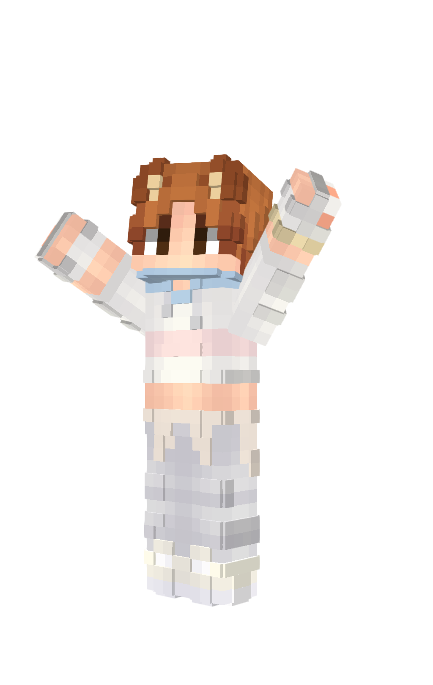

# MC Poser

MC Poser is a browser-based editor for posing Minecraft skins in 3D. Load a skin from a username or PNG, pose it with direct joint controls and viewport gizmos, then export a polished render or share the full scene with a compact link.



[Live app](https://mcposer.pcky.dev) · [Support on Ko-Fi](https://ko-fi.com/pockydev) · [Report an issue](https://github.com/PckyDev/MC-Poser/issues)

Use a desktop device with a modern browser and WebGL support. Mobile devices
are not currently supported.

## Highlights

- Load skins from Mojang username lookups or local PNG files.
- Pose characters with sliders, presets, and in-viewport rotation gizmos.
- Switch between default, bobblehead, advanced, and stylized avatar rigs.
- Bend the lower torso, spine, elbows, and knees with per-joint controls.
- Support classic, slim, and auto-detect arm models.
- Toggle the outer layer, including voxel-style 3D outer layer rendering.
- Choose Classic or Stylized rendering, with soft edge highlights, studio shadows,
  warm surface-edge lighting, and adjustable brightness and warmth.
- Export PNG, JPG, or WebP renders with custom resolution and background settings.
- Generate compact share links for full projects and rendered image outputs.

## Workflow

1. Load a skin from a Minecraft username or a PNG file.
2. Choose an avatar type and arm model.
3. Pose the character in the viewport or inspector.
4. Export a render or share the scene with a link.

### Stylized rendering

Under **Render options**, choose **Stylized** and adjust Brightness, Warmth, and
Glow (soft rear-edge highlights: higher values increase their strength and spread inward across the surface).
Highlights are softened independently of the crisp avatar surfaces and stay inside
the exported silhouette. Enable **3D outer layer** for raised skin details. The style follows the
camera and is included in image exports, saved `.mcpose` files, undo/redo, and
share links. Existing files open in Classic unless they explicitly save a style.
Classic's lit/unlit controls are available again when switching back.

Rendering style and avatar type are separate choices. For a cartoon silhouette,
selecting the Stylized avatar automatically enables Stylized rendering and 3D
outer layers. You can change those settings afterward; opening a saved pose keeps
its saved settings. Click **Render options** to collapse the panel and give the
part inspector more space.

For the stylized proportions,
choose **Document > Avatar Type > Stylized**: it has a slimmer torso and arms,
a larger relative head, legs that widen toward the feet, and subtle bevels, while retaining
the Advanced rig's elbow, knee, and spine controls. Switching back restores the
original proportions. The studio lighting uses soft shadows and color-preserving
shading with warm grazing highlights. Outer layers keep their original thickness.
Advanced and Stylized arms rotate from the shoulder, two pixels below the top,
with their elbows and hand attachments following the same articulated chain.
Exports fit the visible model rather than hidden original limbs.

The skin's artwork is preserved; arbitrary hand-sculpted clothing and hair from
reference illustrations are not recreated automatically. Extra geometry and
lighting can be more demanding on older graphics hardware.

### Java 3D held items

Select an arm, choose **Add Item** (or **Change Item**), and open **Java 3D Model**.
Choose a self-contained Java block/item `.json` exported from Blockbench, then
provide a PNG for each texture listed. Texture aliases, per-face UVs and quarter-turn
UV rotations, cuboid element rotations/rescaling, and multiple textures are supported.
The model's `thirdperson_righthand` and `thirdperson_lefthand` settings determine
its grip, including left-hand mirroring. Manual offsets are applied on top;
**Reset to Default** restores the authored grip. PNG-only items remain available.

Models and their textures travel with saved poses, share links, and diagnostics.
They work with both render styles and all avatar rigs. Larger models can exceed
the existing share-link size limit; save and send the `.mcpose` file instead.

This importer accepts cuboid Java models, not `.bbmodel` projects, Bedrock models,
resource-pack item-definition wrappers, animated textures, or parent-dependent
models. Export inherited elements and display settings into a self-contained
model first. Limits: 2,048 elements, 4 MB source JSON, 2,048 pixels per texture edge,
8 MB per uploaded PNG, and 18 MB total embedded texture data. Texture paths are
labels for selecting local files, not URLs fetched from the model. Imported
models retain their authored geometry instead of receiving avatar bevels.

## Built With

- React 19
- TypeScript 6
- Vite 8
- skinview3d
- Cloudflare Pages Functions

## Getting Started

### Requirements

- Node.js `^20.19.0 || >=22.12.0`
- npm 10 or newer recommended

### Install

```bash
npm ci
```

### Run locally

```bash
npm run dev
```

The local dev server includes the `/api/skin` middleware used for username-based skin lookups.

### Production build

```bash
npm run build
```

### Preview the static build

```bash
npm run preview
```

`npm run preview` serves the static client only and does not include the `/api/skin` lookup route.

### Deploy your own copy

The project targets Cloudflare Pages. Use `npm run build` as the build command,
`dist` as the output directory, and a supported Node.js version. The root
`functions/` directory supplies `/api/skin`; a static-only host will not provide
username lookup unless you implement that endpoint separately. PNG upload does
not depend on username lookup.

The app does not require a Discord webhook to run. The optional GitHub workflow
uses a repository Actions secret named `DISCORD_WEBHOOK_URL` to publish update
notes. Never put the webhook URL in a source file or a client-side variable.

`"private": true` in `package.json` prevents accidental npm publication; it does
not prevent hosting the app or publishing this repository's source.

## Contributing and security

See [CONTRIBUTING.md](CONTRIBUTING.md) for setup, checks, and pull-request guidance.
Community participation follows our [Code of Conduct](CODE_OF_CONDUCT.md).
Use [SECURITY.md](SECURITY.md) for private vulnerability reporting. GitHub issues
provide forms for bugs and ideas; community help is available in **#mc-poser**
on [Pockyverse](https://discord.pcky.dev).

CI checks type safety, the production build, browser regressions, and Discord
update formatting on pull requests and pushes to `main`.

## Licensing and attribution

Original MC Poser code is available under the [MIT License](LICENSE).

See [THIRD_PARTY_NOTICES.md](THIRD_PARTY_NOTICES.md) for dependency and asset
notices. The bundled Minecraft item textures are excluded from the MIT license;
their redistribution terms still need maintainer review.
MC Poser is an independent project, not an official Minecraft product and not
approved by or associated with Mojang or Microsoft.

## Regression tests

```bash
npx playwright install chromium
npm run test:e2e
npm run typecheck
```

The head-underside suite generates asymmetric four-color PNG fixtures and tests the
actual viewer meshes through Chromium. It covers modern classic/slim and legacy
skins, 64px and 128px atlases, opaque and translucent hat pixels, PNG upload and
mocked username lookup, all four avatar rigs, explicit classic/slim arms and
upload auto-detection, and hidden/flat/3D outer layers (including switching back).
Username lookups are mocked for reproducibility, not used as live Mojang API tests.
Geometry probes check all four underside quadrants of both head and hat, including
the separate Advanced voxel renderer. Test-only viewer access is injected by
Playwright into the dev response and is not included in the production bundle.
An additional test switches rigs on the same viewer, captures flat/3D undersides,
and checks that loading a skin without a hat clears the old voxel geometry.

## Support

### Diagnostics for bug reports

Choose **Help > Download Diagnostics**, or use **Download Diagnostics** in
**Help > Report Bug/Issue**. The JSON includes the active document's pose,
skin and held-item images, arm/rig/layer settings, camera, lighting/export
settings, browser/GPU details, build revision, and up to 50 recent uncaught
errors. Failed asset collection is listed in `warnings` without preventing
the rest of the download.

Review the file before sharing: it includes document/image labels, usernames,
and error text. Nothing is uploaded automatically. Cookies, browser storage,
other open documents, and page query strings/share hashes are not collected.
For reproduction, save the report's `workspace` object as a `.mcpose` JSON
file and open it with **File > Open**. Apply camera, lighting, and export
settings from `rendering` and `editor` separately. A warning about a missing
image means that original image is also needed.

The diagnostics Playwright tests verify both entry points, workspace reopening,
error limits, privacy exclusions, and graceful collection failures.

- Support development on Ko-Fi: https://ko-fi.com/pockydev
- Suggest ideas or report bugs through the in-app `Help` menu.
- GitHub issues: https://github.com/PckyDev/MC-Poser/issues
